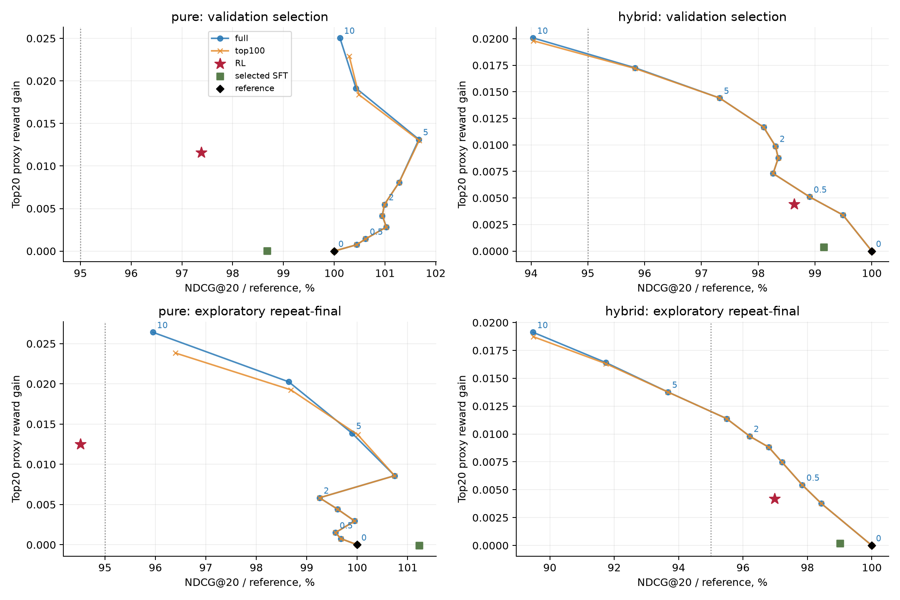

# GPT-2 для последовательных рекомендаций: reward model и RL

Самостоятельная исследовательская сдача на Yambda-50M. Обучены GPT-2 с нуля, модель отклика (RM), REINFORCE с KL к исходной политике; исследованы релевантность, поведение выдач и стоимость обслуживания. **RL повышает proxy-награду, но преимущество по релевантности над сильными альтернативами не установлено. Измеренный практический эффект — инференс изменённой политики без RM в исследованной реализации. Надёжность персонализированного выбора объектов RM остаётся ограничением.**

| Что изменили | Что измерили | Что подтвердилось | Ограничение |
|---|---|---|---|
| Study_03: supervised-рецепт и охват train | CE, ranking, fixed/dynamic контроль | Расширился positive support, снизилась CE | Вклад одного sampling в ranking не установлен |
| Study_04: H1 RL чистой GPT-2, 3 seeds | Та же GPT, time-matched SFT, RL | Proxy растёт и без copy-компонента | Нет установленного преимущества по релевантности |
| Study_04: фиксированная сетка reranking | Полный каталог / top100, validation guards | Простое перевзвешивание даёт сильный компромисс | Конечная сетка; final уже изучался |
| RM: проверка выбора действий | RMSE, within-user error, matched concordance | Общая ошибка ниже, чем у среднего predictor | Concordance 0.522, 95% CI [0.497; 0.548], включает 0.5 |
| Обслуживание | Warm scoring batch64 на MPS | RL не вызывает RM; pure RL 9.12 мс против full rerank 15.47 мс | Один компьютер, без IO/сети/подготовки признаков |

**Статус оценки.** Study_03 — первоначальная финальная оценка на зарезервированной новой пользовательской когорте того же источника. Study_04 мотивирован уже известным final и представляет **исследовательскую повторную оценку**, а не независимое подтверждение. Исходные результаты, протоколы и решения сохранены; адаптация к самостоятельному проекту описана в [PORTING](docs/PORTING.md).

## Задача и данные

Основной вопрос: можно ли увеличить предсказанный пользовательский отклик, сохранив релевантность, персонализацию и разнообразие? Предсказываем следующий наблюдавшийся объект, один item ID — один токен. Награда — модель доли дослушивания **при наблюдавшемся взаимодействии**, а не вероятность принять любую рекомендацию.

Использован [Yambda](https://huggingface.co/datasets/yandex/yambda), `flat/50m/multi_event.parquet`: фактически 47 790 449 событий, 46 467 212 listen-событий, 10 000 пользователей, 934 057 объектов релиза. Обучение и оценка используют listen; остальные типы не превращаются в отрицательные отклики. Воспроизводимо зафиксированы 1 200 development и 500 final пользователей, каталог **131 072** объектов по раннему train (минимум 2 события); это результат на сокращённой выборке и каталоге. Основной supervised pool содержит 5 384 237 допустимых известных train-целей. Исходный cap256/user покрывал положительными целями лишь 63 241 объект.

Снимок HF закреплён revision и SHA256 в [манифесте](configs/data_sources.json). Cohort IDs, catalog mapping и компактные индексы фиксированных контрольных выборок хранятся в `configs/study03`; большие истории создаются из публичных данных. Аудит до/после фильтрации: [таблица](results/study03/tables/target_distributions.csv), [графики](results/study03/figures/data_audit.png). Timestamp относительный; обработка интервалов предполагает секунды, наблюдаемая гранулярность 5 секунд. Это не календарные даты.

| Назначение | Границы timestamp |
|---|---|
| RM fit | < 18 000 000 |
| RM tune / calibration | [18 000 000; 19 000 000) / [19 000 000; 20 000 000) |
| Policy train | < 22 000 000 |
| Validation | [22 000 000; 24 000 000) |
| Final | [24 000 000; 26 000 005) |

Каждая история и её прошлые feedback-признаки строго предшествуют целевой временной метке. Вся группа равных timestamps исключается из истории; внутри неё порядок не выдумывается. Каталог, популярности, нормализация и RM priors вычисляются по train. Checkpoints, коэффициенты и ранняя остановка выбираются по validation. На final — 3 908 общих next-event контекстов / 500 пользователей. OOV-цели остаются в знаменателе с нулевой релевантностью: user-macro доля OOV около **30.33%** на final и **23.67%** на validation, а conditional known-target метрики публикуются отдельно. В evaluation разрешены ранее наблюдавшиеся события до очередной цели, включая более ранние события того же раздела; это последовательная offline оценка, не изолированный одноразовый прогноз от train boundary.

## Модели и обучение

**Чистая GPT-2.** Decoder-only Transformer с нуля: 2 блока, hidden128, 4 головы, context64, 17 182 592 параметра. Обучение next-item cross-entropy; causal/group attention, корректная маска padding, позиции групп timestamps. PAD0/query1/UNK2 отдельные; выходная голова действий включает только item IDs. Это адаптация GPT-2 к временным ties, а не текстовые предобученные веса. AdamW, lr7e−4, wd0.01, batch64, warmup500, cosine floor0.1, 24 000 updates, seeds11/29/47; checkpoint — максимум validation NDCG@20. Основной sampler: пользователь равномерно, затем известная train-цель из полного pool.

**Гибрид.** Те же исходные GPT tensors, но `p = 0.75 p_GPT + 0.25 p_count`; `p_count` — 0.999 нормированных частот доступной истории + 0.001 train popularity (fallback — train popularity). Фиксированная смесь, не дополнительное обучение и не эффект RL. В сравнении также есть popularity, history count, свежий train marginal и продолжение supervised-обучения с временем optimizer body, сопоставленным RL.

**Reward model.** Цель `min(played_ratio_pct / 100, 1)`. Сравнены средний predictor, history-only, candidate-only, joint и residual. Joint использует доступный прошлый feedback, train priors объекта/длительности/популярности, взаимодействия признаков и частоту объекта в истории; калибруется на отдельном train-периоде и замораживается до RL. Второй evaluator — CatBoost другой архитектуры/seed, но с общими upstream признаками, пользователями и калибровкой: это проверка согласованности, не независимое подтверждение полезности.

На final in-catalog RMSE: mean0.430528, history0.392732, candidate0.429529, joint0.392060, evaluator0.412454. Разница total MSE joint−history −0.000528 [−0.001352; +0.000369]. Within-user MSE joint0.126883 хуже постоянного контроля0.123467, хотя немного лучше history0.127535. Matched concordance joint0.522 [0.497; 0.548] не отделена от0.5 и от candidate-only. Полная [таблица ограничений RM](results/study04/tables/RM_evidence.csv) и [парные сравнения](results/study04/tables/RM_contrasts.csv).

Компонента C(history) отражает склонность пользователя дослушивать и постоянна относительно действия; без clipping она сокращается в advantages и экспоненциальном перевзвешивании. Выбор объекта меняют candidate, interaction и repeat-компоненты. Поэтому хороший общий RMSE сам по себе не подтверждает полезность выбора действий.

**RL.** REINFORCE, состояние — реальный префикс (или искусственное продолжение), действие — item выбранного каталога. Начальные состояния user-balanced из сохранённых реальных префиксов train20–22M. Семплирование из фактической categorical policy, temperature1. Detached baseline: ожидаемая награда frozen reference и EMA residual предыдущего batch; RM/reference не получают градиенты. Полный categorical KL вычисляется точно:

`J = E[Σ γ^(t−1) r_t] − β E[Σ KL(πθ || πref)]`, β=0.1, γ=0.9; KL не дисконтирован.

AdamW5e−5, wd0.01, clip1, batch64. H1:640 updates; H5:128, по 40 960 действий/seed. H5 добавляет предложенный item в искусственный контекст при фиксированном feedback; это **генерация списка, не симуляция потребления**. Raw reward сравнен с одной поправкой: вычитается отличие train shrunk mean duration-bin от общего среднего (1000 псевдонаблюдений, коэффициент1). Исторические музыкальные повторы разрешены всем; внутри generated list повтор уже предложенного запрещён одинаково. Чистая GPT получила отдельный H1 RL в study_04; H5 и duration correction относятся к гибриду study_03.

**Сильная альтернатива без RL.** `qλ ∝ pref exp(λ r)`, полный каталог и top100 кандидатов исходной модели; фиксированная сетка λ=0,0.25,0.5,1,1.5,2,3,5,7.5,10. Выбор только validation: максимум R20 при потерях NDCG≤1/3/5% и ближайший прирост награды к RL при guard5%. Reward-matched λ=5 для pure и0.5 для hybrid. Top100 при λ0 сохраняет Top20, но меняет поддержку categorical. RM/reranker видят прошлый feedback, actor — только item history: разница включает ограничение информации/класса политик.

## Ключевые результаты

Ниже — study_04, **исследовательская повторная оценка**; frozen hybrid-контроли перенесены из study_03. Средние по пользователям, затем 3 seeds. R20 — среднее **предсказаний RM** в Top20, не наблюдавшийся response и не ожидаемый reward categorical. Полный выбранный каталог, одинаковые контексты, без sampled negatives.

<!-- key-results:start -->
| Политика | NDCG@20 | Recall@20 | R20 proxy | Evaluator R20 |
|---|---:|---:|---:|---:|
| Чистая GPT-2 | 0.016650 | 0.042524 | 0.684016 | 0.663084 |
| Чистая + SFT | 0.016854 | 0.042440 | 0.683927 | 0.662982 |
| Чистая + RL H1 | 0.015736 | 0.040940 | 0.696526 | 0.670421 |
| Чистая + full rerank λ5 | 0.016632 | 0.042774 | 0.697891 | 0.670527 |
| Гибрид α0.25 | 0.046963 | 0.106528 | 0.681262 | 0.658952 |
| Гибрид + SFT | 0.046499 | 0.106500 | 0.681441 | 0.658900 |
| Гибрид + RL H1 | 0.045547 | 0.104917 | 0.685448 | 0.661109 |
| Гибрид + full rerank λ0.5 | 0.045948 | 0.104278 | 0.686695 | 0.663011 |
<!-- key-results:end -->

Таблица автоматически сверяется с [selected_mean.csv](results/study04/tables/selected_mean.csv). [Seed SD](results/study04/tables/selected_seed_sd.csv) и [парный bootstrap](results/study04/tables/paired_bootstrap.csv): 2000 ресемплов пользователей после усреднения seed-разниц внутри пользователя; nominal95% CI без поправки за множественность, условно на одной RM и выборке. Pure RL−base R20 +0.012510 [0.012058;0.012956], ΔNDCG −0.000913 [−0.001771;+0.000039]. Pure RL−matched rerank ΔNDCG −0.000896 [−0.001514;−0.000277]. У hybrid RL−base ΔNDCG −0.001416 [−0.002298;−0.000587], R20 +0.004186 [0.003897;0.004489]. Validation guard не гарантирует перенос на final; pure RL точечно теряет5.49% NDCG.



Конечная сетка не доказывает глобальный Pareto frontier. При matched Top20 reward pure reranking сильнее RL; у hybrid различие NDCG не установлено. Выбор λ на validation не обеспечивает точного совпадения прироста reward на final. Ожидаемый categorical reward, KL и J показаны отдельно в [подробном отчёте](docs/REPORT.md): сравнение Top20 нельзя переносить на весь objective или авторегрессионный список.

## Ответы на пять исследовательских вопросов

1. **Можно ли отделить качество GPT-2 от copy и RL?** Да: чистая GPT, фиксированная смесь и RL относительно каждой исходной политики представлены отдельно. Улучшение всего supervised-рецепта не приписано одному sampler; контроль его NDCG пересекает ноль. Pure RL тоже меняет proxy, поэтому эффект не сводится к copy.
2. **Насколько RM пригодна для выбора рекомендаций?** Общая ошибка улучшилась главным образом за счёт history propensity. Надёжный action-sensitive персонализированный выбор не подтверждён matched CI. Отсюда главный предел интерпретации RL.
3. **Даёт ли RL лучший компромисс, чем простые альтернативы?** Преимущество по релевантности не установлено; сильный reranking конкурентен. Измеренная практическая разница — отсутствие RM на serving. Pure RL9.12/full15.47/top10016.44 мс на batch64; hybrid12.66/19.31/20.33 мс. Top100 здесь не быстрее full. Это локальный warm benchmark, не production SLA.
4. **Как меняются рекомендации?** Raw RL смещает выдачи к коротким и популярным объектам, повышает межпользовательское сходство и концентрацию, снижает coverage; artist distance при этом растёт. Повторы истории у hybrid уменьшаются, у pure изменение не установлено. Duration correction возвращает2.65с средней длительности ценой proxy. [Поведение и примеры](docs/REPORT.md), [фактические выдачи](docs/EXAMPLES_STUDY04.md).
5. **Что известно о горизонте и долгосрочной полезности?** H5 в искусственной среде не подтвердил рост response return; выигрыш J главным образом от меньшего KL. RM disagreement — слабая диагностика sequence OOD. Retention как эффект политики не измерен. Без exposures/propensities IPS/DR не выдаются за причинную оценку; необходим онлайн-тест возвращения/удовлетворённости с защитными skip/relevance/diversity/duration метриками.

## Ресурсы и стоимость

Mac M4 Pro, 48 GiB unified memory, 20 GPU cores, MPS, Python3.12, torch2.14.1; платные ресурсы не использовались. Три основных supervised fit по24k updates: около18 минут active elapsed/seed (точные [timing](results/study03/tables/timing.csv)); исторические pilots и подготовка отдельно. Pure H1 RL optimizer body42–44с/seed; paired SFT42–44с, 960–989updates. Для SFT выбран last у11 и initial у29/47 после реально выполненных fit. Hybrid H1 около49с/seed. Шесть новых fit study_04 суммарно256.3с optimizer body, все активные стадии дополнения около705с. Календарное время может включать сон ноутбука; peak memory не измерена. [Стоимость по seeds](results/study04/tables/training_cost.csv).

## Воспроизведение из корня репозитория

Python3.12 и новое окружение; pinned зависимости проверены на macOS arm64. Для другой платформы доступность тех же wheels не гарантируется.

```bash
python3.12 -m venv .venv
.venv/bin/python -m pip install -r requirements.lock.txt
.venv/bin/python scripts/download_data.py
.venv/bin/python -m pytest -q
# Маленький полный конвейер: public-development smoke03 + synthetic smoke04, CPU.
.venv/bin/python scripts/reproduce.py smoke --out runs/smoke
# Полное историческое исследование из public raw, включая обе стадии; новый output.
.venv/bin/python scripts/reproduce.py full --out runs/full --device mps
```

Для CPU замените `--device mps` на `--device cpu` (полный запуск существенно медленнее). Полная команда воспроизводит исторический ограниченный pilot/выбор по validation; новые диапазоны поиска не вводятся. Готовые веса ей не нужны. Дополнительный frozen old-GPT контроль — архивная иллюстрация прежнего рецепта, автоматически не переобучается; обязательные финальные сравнения самостоятельны.

Быстрый smoke требует двух публичных parquet (~423 MB), но не тяжёлых модельных архивов. Обычно занимает десятки секунд после импорта библиотек; его числа не исследовательские результаты. Для проверки только формул/масок достаточно pytest без данных. **Полное исследовательское обучение при сборке этой сдачи заново не запускалось.** Выполнены новое locked окружение, тесты, оба маленьких end-to-end pipeline, exact reconstruction контрольных массивов, пересчёт таблиц/метрик и inference replay весов; точные итоги — [VALIDATION](docs/VALIDATION.md).

Если доступны два отдельных архива весов/историй, их можно проверить и импортировать, затем пересчитать сохранённые результаты без обучения:

```bash
.venv/bin/python scripts/artifacts.py --study 03 --file downloads/study03_artifacts.zip
.venv/bin/python scripts/artifacts.py --study 04 --file downloads/submission_artifacts.zip
.venv/bin/python scripts/reproduce.py tables
.venv/bin/python experiments/study04/replay.py --device cpu
.venv/bin/python scripts/check_submission.py
```

**Публичные ссылки на эти архивы пока отсутствуют**; `downloads/...` — место для предоставленных файлов, не ссылка для скачивания. Состав, точные размеры и SHA256 — в [ARTIFACTS](docs/ARTIFACTS.md). Код можно переобучить из публичных данных независимо от готовых весов. Команды отдельных этапов, критерии выбора и уровни воспроизводимости — в [REPRODUCIBILITY](docs/REPRODUCIBILITY.md).

## Состав сдачи и ограничения

- [Краткий текст для проверяющего](docs/FOR_REVIEWER.md), [подробный итоговый отчёт study_04](docs/REPORT.md), [исходное исследование study_03](docs/STUDY03.md), [методы](docs/METHODS.md), [источники](docs/SOURCES.md).
- [Протокол study_03](docs/PROTOCOL_STUDY03.md), [изменения до его final](docs/DECISIONS_STUDY03.md), [протокол дополнения](docs/PROTOCOL_STUDY04.md).
- `recsys/` — общие ML-модули; `experiments/study03` и `experiments/study04` — сценарии; `configs/` — seeds, границы и frozen selections; `tests/` — проверки; `results/` — небольшие агрегаты/графики.

Выводы ограничены сокращённым каталогом, отбором активных пользователей upstream, коротким контекстом, тремя policy seeds и одной основной RM. Repeat-final и многократное использование validation не являются независимой проверкой гипотез. Улучшение proxy **не доказывает** рост дослушивания, удовлетворённости или retention. Разумные дальнейшие шаги: action-sensitive RM с более подходящими данными об экспозициях, отдельный untouched holdout и онлайн-проверка; они здесь не выполнены. Сторонним данным/коду произвольная лицензия не назначается: [THIRD_PARTY_NOTICES](THIRD_PARTY_NOTICES.md).
