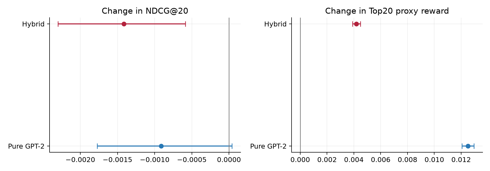
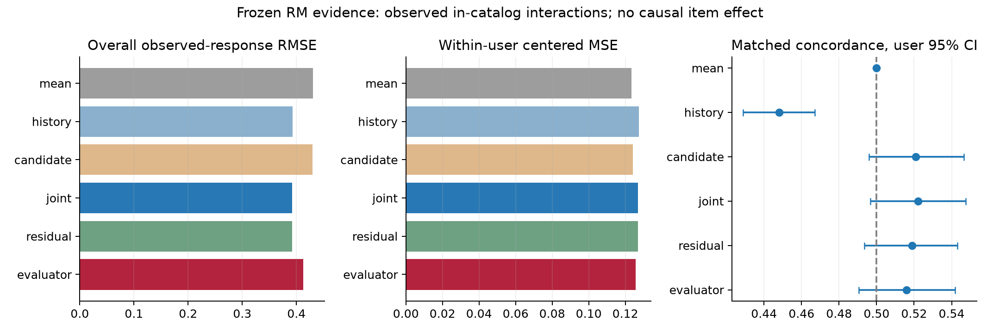
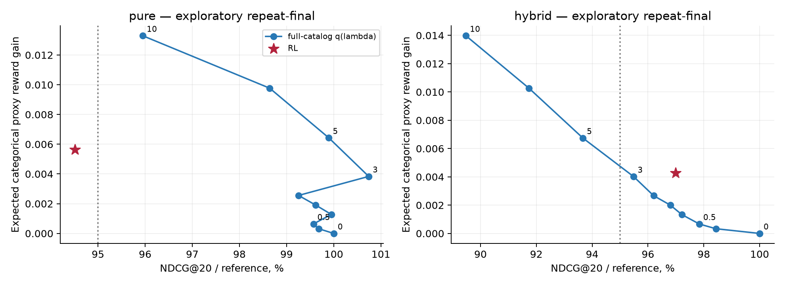
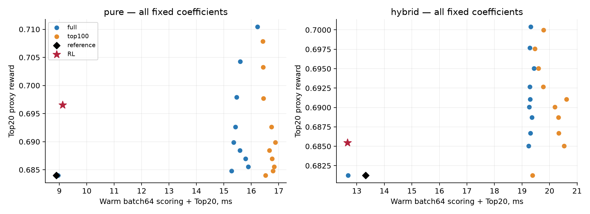

# GPT-2, reward model и RL: итоговая сдача с ограниченным дополнением

**Study03 сохранён без изменений. Study04 — отдельное дополнение, мотивированное уже известным final. Все его final-результаты — исследовательская повторная оценка, а не независимое подтверждение.** Три policy seeds 11/29/47, 500 пользователей, 3908 одинаковых next-item контекстов, полный выбранный каталог 131072. Средние сначала по событиям пользователя, затем по пользователям и seeds. Исходный [отчёт study03](STUDY03.md) и его история решений не переписаны.

| Что изменили | Что измерили | Что подтвердилось | Ограничение |
|---|---|---|---|
| Study03: расширили supervised support и изменили рецепт | Контролируемый cap-пилот; старые/новые GPT на общих контекстах | Чистая GPT стала сильнее; эффект нового рецепта отделён от copy и RL | Изолированный cap-контроль улучшил CE; ranking CI включает 0 |
| Study04: RL непосредственно чистой GPT, 3 seeds | H1 против той же чистой модели и time-matched SFT | ΔR20 +0.012510; NDCG 5.49% ниже точечно | NDCG CI включает 0; эффект на реальную полезность не установлен |
| Study04:10 λ ×2 семейства ×2 reference ×3 seeds | Все кривые; выбор только validation; одинаковые guards/близкий reward | Pure λ5: NDCG 0.016632 против RL 0.015736 | Конечная сетка, повторный final; matching не означает точного равенства reward |
| RM: объединили action-sensitive диагностики | Общая/within ошибка; matched concordance; evaluator | Joint concordance 0.522 [0.497; 0.548], включает 0,5 | Надёжный персонализированный выбор объекта не подтверждён |
| Проверили стоимость и воспроизводимость | Warm batch64; frozen hashes; CPU smoke и replay | RL обходится без RM на инференсе; код и малые результаты включены; ссылки на тяжёлые архивы пока не опубликованы | Локальный benchmark; полное переобучение при release QA не повторялось |

**Главный вывод. Эксперимент показывает управляемое изменение политики под заданный proxy; реальную полезность этого изменения данные пока не устанавливают.** Чистая GPT-2 действительно дообучена RL, но надёжного преимущества RL над сильнее настроенным переранжированием по качеству рекомендаций нет. Измеренное преимущество RL — возможность обслуживать изменённую политику без вызова RM. Оно сопровождается затратой на обучение, изменением длительности/концентрации и слабой проверенностью action-sensitive RM.

## Постановка и границы доказательства

Разделяем три изменения: новый supervised-рецепт study03; добавление фиксированной частоты истории α=0,25; RL относительно каждой из этих двух исходных политик. Их эффекты не складываются в один «эффект RL». Чистый GPT и гибрид до RL имеют **одинаковые обучаемые tensors**, что проверено; разница — смесь распределений. В дополнении заново обучены только 3 pure RL и 3 pure SFT. RM, основные GPT checkpoints и прежние hybrid RL/SFT заморожены.

Глобальные временные границы, истории и mappings прежние: policy train<22M, validation22–24M, final24M–26000005; RM fit/tune/calibration до 20M. История строго раньше target timestamp; равные timestamps не упорядочиваются искусственно. Статистики train-only. Actor видит только item history и timestamp groups; RM и serving reranker дополнительно получают доступные прошлые feedback summaries. Это различие информации/класса политик раскрыто: разница с аналитическим q не изолирует качество оптимизатора от ограничений аппроксимации. Служебные токены отсутствуют в action head. В музыке прошлые повторы разрешены одинаково, в generated list повтор уже предложенного объекта запрещён всем. Каталог 131072 — сокращённый train-defined каталог 934057-item релиза, не весь Yambda. OOV-цели остаются в основном знаменателе с нулевой релевантностью. Полные определения — [Methods](METHODS.md), [исходный protocol дополнения](PROTOCOL_STUDY04.md).

Всё выбрано по validation. Protocol и бюджет 3600 active seconds зафиксированы перед новыми fits/inference; после final диапазон, коэффициенты, RM и checkpoints не менялись. Старый holdout уже известен, validation тоже многократно используется в развитии исследования; новые интервалы не превращают повторную оценку в blind test. Техническая ошибка импорта и derived-only repairs раскрыты в [ENGINEERING](PORTING.md); оригинальный seal сохранён, дочерний repair seal не меняет learned weights или selection.

## 1. Исправлена ли слабость GPT-2 и отделён ли её эффект от RL?

Study03 установил ограничение сохранённого cap256/user: **63241/131072 (48,25%)** объектов имели положительные CE-цели против всех 131072 в полном eligible train pool. Обновляемые user-balanced draws фактически показали основной модели около 108 тыс разных положительных объектов за 24000 updates. В контролируемом 8000-step pilot fixed→dynamic при одинаковых остальных условиях Δvalidation CE −0,2878 [−0,3294; −0,2406], но ΔNDCG20 +0,001407 [−0,000940; +0,003796] не отделён от нуля. Значит обеднение train подтверждено, а весь ranking-выигрыш нельзя приписать одному семплированию.

На **одних новых study03 контекстах** frozen old GPT NDCG20=0,007493, новая чистая=0,016650; это эффект полного нового рецепта с иным бюджетом, не изолированный sampling effect. Гибрид 0,046963 против count0,044107 и fresh-marginal+count0,044816; последнее различие небольшое, nominal CI почти касается 0. Copy объясняет существенную часть качества, поэтому чистая модель обязательно остаётся в таблице. Полная исходная доказательная база — [study03](STUDY03.md), [cap-control](../results/study03/tables/cap_control_bootstrap.csv), [old/new и абляции](../results/study03/tables/paired_differences.csv).

Теперь проверен отдельный RL-эффект на чистой GPT:

| Политика | NDCG20 ± seedSD | Recall20 | R20 proxy | Evaluator R20 | Eπ[r] | KL к reference |
|---|---|---|---|---|---|---|
| Чистая GPT-2 | 0.016650 ± 0.000955 | 0.042524 | 0.684016 | 0.663084 | 0.668257 | 0.000000 |
| Чистая + SFT (selected) | 0.016854 ± 0.000937 | 0.042440 | 0.683927 | 0.662982 | 0.668149 | 0.035250 |
| Чистая + RL H1 | 0.015736 ± 0.001152 | 0.040940 | 0.696526 | 0.670421 | 0.673882 | 0.036063 |
| Гибрид α=0,25 | 0.046963 ± 0.000512 | 0.106528 | 0.681262 | 0.658952 | 0.670311 | 0.000000 |
| Гибрид + SFT | 0.046499 ± 0.000300 | 0.106500 | 0.681441 | 0.658900 | 0.669927 | 0.079916 |
| Гибрид + RL H1 | 0.045547 ± 0.000336 | 0.104917 | 0.685448 | 0.661109 | 0.674584 | 0.028212 |

Источник: [все seeds](../results/study04/tables/selected_seeds.csv), [средние](../results/study04/tables/selected_mean.csv), [seed SD](../results/study04/tables/selected_seed_sd.csv). R20 — средняя предсказанная награда 20 ранжированных объектов; Eπ[r] — ожидание под всем categorical, это разные величины. Номинальные paired95%CI получены 2000 bootstrap-перевыборками **пользователей**, после усреднения seed-specific эффекта внутри пользователя. Policy seeds не являются тремя независимыми RM fits.

| Парный контраст | ΔNDCG20 [95%CI] | ΔR20 [95%CI] |
|---|---|---|
| pure_rl - pure | -0.000913 [-0.001771; +0.000039] | +0.012510 [+0.012058; +0.012956] |
| pure_rl - pure_sft | -0.001118 [-0.002025; -0.000171] | +0.012600 [+0.012127; +0.013057] |
| hybrid_rl - hybrid | -0.001416 [-0.002298; -0.000587] | +0.004186 [+0.003897; +0.004489] |
| pure_rl - pure_full_reward_match | -0.000896 [-0.001514; -0.000277] | -0.001365 [-0.001710; -0.001054] |
| pure_rl - pure_top100_reward_match | -0.000915 [-0.001528; -0.000304] | -0.001168 [-0.001493; -0.000874] |
| hybrid_rl - hybrid_full_reward_match | -0.000401 [-0.001444; +0.000598] | -0.001247 [-0.001709; -0.000798] |
| hybrid_rl - hybrid_full_tol01 | -0.000513 [-0.001498; +0.000428] | -0.000127 [-0.000560; +0.000298] |
| copy_interaction: (pureRL-pure)-(hybridRL-hybrid) | +0.000502 [-0.000359; +0.001443] | +0.008324 [+0.007959; +0.008678] |

Источник: [полные парные контрасты](../results/study04/tables/paired_bootstrap.csv). У чистой RL точечная потеря NDCG 5.49%, но CI разницы с чистой исходной включает 0; относительно выбранного SFT снижение поддержано nominal CI. У гибрида потеря 3.01% поддержана CI. Difference-of-differences NDCG не устанавливает зависимость потери релевантности от copy; разница прироста proxy +0.008324 [+0.007959; +0.008678] подтверждает разный отклик двух параметризаций на эту оптимизацию. Это не изоляция всех механизмов copy за пределами данного фиксированного α/бюджета.



## 2. Научилась ли RM выбирать объекты сверх склонности пользователя дослушивать?

**Надёжное персонализированное различение объектов не подтверждено.** Цель замороженной RM — min(played_ratio_pct/100, 1) на observed listen: доля прослушивания при наблюдавшемся взаимодействии, а не вероятность принятия любой рекомендации. Объединённая таблица относится к 10863 observed in-catalog взаимодействиям 494 пользователей. Matched диагностика:410 users, 4580 пар разных объектов при близких доступных контекстах. Ни одна ненаблюдавшаяся рекомендация не объявлена отрицательной. «Общий» означает ошибку без центрирования в этом action domain, а не по всему исходному каталогу. Дополнительная польза кандидата выражена парной ΔMSE, поскольку RMSE не аддитивен по пользователям.

| RM | Общий in-catalog RMSE | Calibration gap | ΔMSE сверх history [95%CI] | Within MSE | Matched concordance [95%CI] |
|---|---|---|---|---|---|
| mean | 0.430528 | 0.025245 | — | 0.123467 | 0.500 [0.500; 0.500] |
| history | 0.392732 | 0.011921 | — | 0.127535 | 0.448 [0.429; 0.467] |
| candidate | 0.429529 | 0.025301 | — | 0.124204 | 0.521 [0.496; 0.547] |
| joint | 0.392060 | 0.010453 | -0.000528 [-0.001352; +0.000369] | 0.126883 | 0.522 [0.497; 0.548] |
| residual | 0.392052 | 0.009881 | -0.000534 [-0.001366; +0.000352] | 0.126896 | 0.519 [0.494; 0.543] |
| evaluator | 0.412454 | 0.051864 | +0.015880 [+0.011674; +0.020022] | 0.125664 | 0.516 [0.490; 0.542] |

Источник: [RM evidence](../results/study04/tables/RM_evidence.csv), [парные контрасты](../results/study04/tables/RM_contrasts.csv). Ранее опубликованные RMSE/within estimates сверены до 1e−12; новых RM fits нет. Добавлен интервал evaluator в той же matched диагностике. Calibration gap — взвешенная разница предсказаний/меток по группам предсказаний, не вероятность принятия рекомендации.

Joint улучшает within MSE относительно history на −0,000652 [−0,001231; −0,000043], но **within MSE хуже простого среднего и candidate-only**. Общая ΔMSE к history включает 0. Matched joint−candidate +0,001147 [−0,016668; +0,019377]; joint−history положителен главным образом на фоне history-only concordance ниже 0,5. Собственный joint CI [0.497; 0.548] включает 0,5. Поэтому прирост общего RMSE или контраст с неудачным history-control нельзя называть достоверной полезностью action choice.

Evaluator — CatBoost иной архитектуры/seed, обученный на половине общего fit sample; shared users/features/priors и общий calibration period сохраняются. Его RMSE 0.4125, calibration gap 0.0519, matched interval [0.490; 0.542] тоже включает 0,5. Согласие reward/evaluator при сдвиге политики — диагностическое наблюдение, а не независимая проверка пользовательской полезности.

До clipping reward имеет вид **C(history)+D(candidate)+I(history, candidate)+repeat·b(history)**. C включает прошлую долю потребления, нулевые отклики, разброс, объём доступной обратной связи и производные признаки: на одном состоянии он одинаков для любого действия. D/I/repeat зависят от выбора; признаки кандидата — длительность, популярность и shrinkage-приоры отклика из train. Вне насыщения C отменяется в exp-reweighting и action advantages. Clipping может менять границы насыщения, но не делает пользовательскую склонность доказанным эффектом объекта. В синтетическом продолжении feedback фиксирован; повтор/усечение контекста не заменяют модель пользовательского перехода.



## 3. Что RL добавляет относительно сильных альтернатив без RL?

Проверено ровно 10λ:0; 0,25; 0,5; 1; 1,5; 2; 3; 5; 7,5; 10. Full: q∝p_ref exp(λr). Top100: то же внутри 100 исходных кандидатов, хвост 0. Нулевая full-политика — настоящий reference. Нулевая top100 сохраняет Top20, но уже меняет sampling support; её KL и E[r] нельзя трактовать как исходную политику. Все кривые и captured mass сохранены: [validation](../results/study04/tables/validation_curve_seeds.csv), [repeat-final](../results/study04/tables/final_curve_seeds.csv).

Validation выбирает максимальный R20 при допустимой потере NDCG1/3/5%, и отдельно ближайший к приросту RL R20 вариант под 95% guard. Для reward matching выбраны full λ5 у чистой и λ0.5 у гибрида (top100 — соответственно 5 и 0.5); это решения **до повторного final**. Отсутствует последующая подгонка коэффициента или интерполяция.

| Validation rule | λ seeds11/29/47 | NDCG20 | R20 | Потеря NDCG среднего | Final guard по seeds |
|---|---|---|---|---|---|
| pure_full_tol01 | 10,10,10 | 0.015975 | 0.710431 | 4.05% | 1/3 |
| pure_full_tol03 | 10,10,10 | 0.015975 | 0.710431 | 4.05% | 1/3 |
| pure_full_tol05 | 10,10,10 | 0.015975 | 0.710431 | 4.05% | 1/3 |
| pure_full_reward_match | 5,5,5 | 0.016632 | 0.697891 | 0.10% | 3/3 |
| pure_top100_tol01 | 10,10,10 | 0.016050 | 0.707853 | 3.60% | 1/3 |
| pure_top100_tol03 | 10,10,10 | 0.016050 | 0.707853 | 3.60% | 1/3 |
| pure_top100_tol05 | 10,10,10 | 0.016050 | 0.707853 | 3.60% | 2/3 |
| pure_top100_reward_match | 5,5,5 | 0.016651 | 0.697695 | -0.01% | 3/3 |
| hybrid_full_tol01 | 0.25,0.5,0.25 | 0.046060 | 0.685575 | 1.92% | 0/3 |
| hybrid_full_tol03 | 5,5,2 | 0.044294 | 0.693728 | 5.68% | 0/3 |
| hybrid_full_tol05 | 7.5,7.5,5 | 0.043251 | 0.696807 | 7.90% | 0/3 |
| hybrid_full_reward_match | 0.5,0.5,0.5 | 0.045948 | 0.686695 | 2.16% | 3/3 |
| hybrid_top100_tol01 | 0.25,0.5,0.25 | 0.046060 | 0.685575 | 1.92% | 0/3 |
| hybrid_top100_tol03 | 5,5,2 | 0.044294 | 0.693721 | 5.68% | 0/3 |
| hybrid_top100_tol05 | 7.5,7.5,5 | 0.043251 | 0.696743 | 7.90% | 0/3 |
| hybrid_top100_reward_match | 0.5,0.5,0.5 | 0.045948 | 0.686695 | 2.16% | 3/3 |

Источник: [selection](../results/study04/tables/validation_selection.csv), [перенос guards по seeds](../results/study04/tables/selection_transfer.csv). «Final guard» проверяет именно заявленный validation tolerance, не новый порог. Потеря среднего и доля прошедших seeds — разные агрегаты. Все validation selections прошли собственный guard; многие не сохранили его на повторном final. Например у гибрида 5%-правило дало около 7,9% средней потери и 0/3 прошедших; у чистого RL средняя потеря вышла за 5% несмотря на все passed validation. Это не гарантии соблюдения ограничения на новых данных.

**Реальные префиксы, Top20.** Pure matched rerank даёт одновременно выше NDCG и R20, чем pureRL; paired CIs обеих разниц RL−rerank отрицательны. У гибрида λ0,5 даёт выше proxy/evaluator и близкую релевантность, но разница NDCG не установлена. Reward matching не идеален на повторном final: mean R20 gain rerank превосходит RL примерно на 11% у pure и 30% у hybrid; правило было выбрано на validation, не исправляется после просмотра этих чисел. Дополнительно **заранее выбранное 1%-правило** гибрида даёт почти тот же R20, что RL: Δ(RL−rerank) -0.000127 [-0.000560; +0.000298], при NDCG разнице -0.000513 [-0.001498; +0.000428]. Это близкий по награде контраст, но он не превращается в новый post-final selector.


Кривая — конечный набор фиксированных λ, соединённый для чтения; это не доказательство глобального Pareto frontier. Нельзя объявлять RL победителем или доминируемым во всех постановках по одному R20-графику. В частности, критерий обучения использует **ожидаемый** reward, а не средний Top20:

| Categorical policy | Eπ[r] | KL | Jβ=0.1 | NDCG20 |
|---|---|---|---|---|
| pure | 0.668257 | 0.000000 | 0.668257 | 0.016650 |
| pure_rl | 0.673882 | 0.036063 | 0.670276 | 0.015736 |
| pure_full_reward_match | 0.674684 | 0.016127 | 0.673071 | 0.016632 |
| pure_full_lambda10 | 0.681553 | 0.067952 | 0.674758 | 0.015975 |
| hybrid | 0.670311 | 0.000000 | 0.670311 | 0.046963 |
| hybrid_rl | 0.674584 | 0.028212 | 0.671763 | 0.045547 |
| hybrid_full_reward_match | 0.670978 | 0.000167 | 0.670962 | 0.045948 |
| hybrid_full_lambda10 | 0.684284 | 0.071485 | 0.677136 | 0.042022 |

Источник: [saved expected reward/KL/J](../results/study04/tables/final_curve_seeds.csv), [core](../results/study04/tables/selected_seeds.csv). Full λ10 — точный H1 optimum J при β0,1 на каждом фиксированном состоянии (x, g, feedback) в неограниченном классе categorical; поэтому RL не может улучшить этот proxy-оптимум. Actor ограничен pθ(x, g) без явных feedback inputs, поэтому не обязан уметь представить этот q; это также информационная/аппроксимационная асимметрия, а не чистое соревнование оптимизаторов. Более слабый full rerank, сопоставленный по R20, может иметь **меньше Eπ[r], чем RL**, особенно у гибрида; R20-сопоставление не равно совпадению распределений или оптимизируемой цели. Top100 renormalization меняет KL существенно; его J не смешивается с full-политикой. Модельная награда остаётся непроверенным surrogate независимо от математической оптимальности.



Практическая разница — амортизация. Positive-λ rerank вызывает RM на инференсе; RL — только GPT(и count для гибрида). На одной машине измерено:

| Serving policy | Warm batch64, мс | Кандидатов RM на запрос |
|---|---|---|
| Чистая GPT-2 | 8.89 | нет |
| Чистая + RL H1 | 9.12 | нет |
| pure_full_reward_match | 15.47 | 131072 |
| pure_top100_reward_match | 16.44 | 100 |
| Гибрид α=0,25 | 13.32 | нет |
| Гибрид + RL H1 | 12.66 | нет |
| hybrid_full_reward_match | 19.31 | 131072 |
| hybrid_top100_reward_match | 20.33 | 100 |

Источник: [все warm измерения](../results/study04/tables/latency_seeds.csv), [validation-selected latency](../results/study04/tables/selected_latency_seeds.csv). Batch64,2 warmups+5 repeats, median внутриseed и затемmedianseeds. IO, подготовка feedback, сеть и batching delay исключены. Top100 не оказался быстрее full в этой tensorized RM-реализации: меньше кандидатов не гарантирует меньшую задержку. Эта стоимость относится к данному коду/оборудованию, не productionSLA. Примерная экономия RL против full reward-matched составляет 6–7 мс/batch64 после около 42–44 с optimizer compute/seed; перенос такой оценки на число обслуженных запросов требует реального batching и учёта переобучений RM/policy.



## 4. Как меняются релевантность, популярность, повторы, длительность и персонализация?

| Политика | Длительность, с | Top decile | History repeat | Coverage | HHI | Inter-user Jaccard | Artist distance |
|---|---|---|---|---|---|---|---|
| Чистая GPT-2 | 199.13 | 0.8968 | 0.0931 | 0.0634 | 0.000837 | 0.009100 | 0.9611 |
| Чистая + RL H1 | 189.00 | 0.9182 | 0.0928 | 0.0567 | 0.001247 | 0.013748 | 0.9640 |
| Гибрид α=0,25 | 204.18 | 0.7449 | 0.8795 | 0.1275 | 0.000349 | 0.003748 | 0.9460 |
| Гибрид + RL H1 | 201.15 | 0.7581 | 0.8465 | 0.1239 | 0.000487 | 0.005220 | 0.9475 |

Источник: [сохранённые macro metrics](../results/study04/tables/selected_mean.csv), [парные разницы](../results/study04/tables/paired_bootstrap.csv). В музыке повтор истории сам по себе не ошибка, а описательная характеристика: реальные релевантные события тоже могут повторяться. Coverage — доля выбранного каталога, увиденная вTop20 хотя бы раз; HHI — концентрация user-weighted выдач. Jaccard — сходство Top20 разных пользователей(одинаковые фиксированные пары); выше означает меньше различий между выдачами. Artist distance выше при большем различии artist sets; это одна грань разнообразия, не общая удовлетворённость.

У pureRL длительность меняется на -10.128 [-10.468; -9.784]с, доля popular decile на +0.021416 [+0.019319; +0.023628]; у hybridRL длительность -3.033 [-3.286; -2.781]с. Обе политики становятся более концентрированными и похожими между пользователями, coverage падает. При этом artist distance растёт: нельзя описывать эффект как ухудшение всех видов разнообразия. Склонность к истории-повторам у pure почти не меняется(CI включает 0), у гибрида уменьшается примерно на 3,3 п.п.; гипотеза «raw reward обязательно усиливает повторы» не поддерживается.

В исходном study03 единственная duration correction возвращала большую часть сокращения длительности и несколько смягчала релевантностный ущерб; это прежний замороженный результат, не новый supplement fit. [Исходная таблица](../results/study03/tables/main_mean.csv) и [bootstrap](../results/study03/tables/paired_differences.csv) сохранены. Новые компоненты reward после repeat-final не добавлялись.

**Авторегрессионный список 5 — отдельный режим.** Генерируем greedily, добавляем рекомендацию в искусственный контекст, feedback фиксирован, одинаковая mask уже предложенных. Релевантен всё тот же исходный next item, а не пять позиций из другой реальной траектории. Все итоговые значения — user macro:

| Авторегрессионный список 5 | NDCG5 | Recall5 | Mean generated proxy | Evaluator |
|---|---|---|---|---|
| Чистая GPT-2 | 0.007430 | 0.011500 | 0.689965 | 0.665839 |
| Чистая + SFT (selected) | 0.007758 | 0.012000 | 0.689804 | 0.665786 |
| Чистая + RL H1 | 0.006573 | 0.010500 | 0.710972 | 0.676194 |
| pure_full_reward_match | 0.006645 | 0.010083 | 0.708938 | 0.674766 |
| pure_full_tol05 | 0.007140 | 0.011361 | 0.725592 | 0.681676 |
| Гибрид α=0,25 | 0.027910 | 0.043306 | 0.687932 | 0.661021 |
| Гибрид + SFT | 0.027384 | 0.042944 | 0.687919 | 0.660467 |
| Гибрид + RL H1 | 0.025670 | 0.040139 | 0.699431 | 0.666210 |
| hybrid_full_reward_match | 0.027472 | 0.043028 | 0.691866 | 0.663603 |
| hybrid_full_tol05 | 0.024618 | 0.038917 | 0.713347 | 0.673790 |

Источник: [slate means](../results/study04/tables/slate_mean.csv), [slate paired CI](../results/study04/tables/slate_bootstrap.csv). В этом режиме pureRL−pure ΔNDCG5 -0.000857 [-0.001815; +0.000051]; hybridRL−hybrid -0.002240 [-0.003621; -0.001046]. Выбранный по single-step R20 matched rerank **не обязан** совпадать с RL по generated-list reward: pureRL−full-match +0.002034 [+0.001537; +0.002519], при ΔNDCG5 -0.000072 [-0.000844; +0.000683]. Поэтому вывод о Top20-доминировании pure rerank не переносится автоматически на rollout. У гибрида RL в списке повышает proxy относительно matched rerank, теряя релевантность. Нового выбора λ под список не было.

[Три фактических примера до/после](EXAMPLES_STUDY04.md) показывают анонимные item IDs и связь с общей статистикой. Они выбраны прозрачным описательным правилом, не представляют средний эффект.

## 5. Какие выводы устойчивы, какие ограничены постановкой и что проверять онлайн?

Устойчивое наблюдение в данном протоколе — политика поддаётся сдвигу к заданному proxy; это происходит и у **чистой GPT**, не только через фиксированную частоту. Но размер proxy-сдвига и побочные эффекты зависят от параметризации, а различие потери NDCG между pure/hybrid статистически не установлено. Более сильная сетка no-RL существенно меняет интерпретацию: уникальное преимущество RL по relevance–R20 не показано; оправданный измеренный аргумент за него — отсутствие RM на serving. Даже он требует учитывать обучение/обновления и актуальную production latency.

Главное ограничение — action-sensitive reward: надёжность выбора объектов на новых рекомендациях не доказана. У моделей отсутствует экспериментальная информация о показах и counterfactual откликах; оценка на observed interactions не равна вероятности принятия любой рекомендации. Независимый evaluator не независим по данным. Bootstrap условен на фиксированную RM и повторно исследуемый источник; номинальные CI без multiplicity correction не являются подтверждающей статистикой. Всего 3 policy seeds, не 3 reward/data replications. Relevance guard на validation не гарантирует его перенос на final.

Study03 H1/H5 и real-prefix/synthetic диагностики остаются отдельным историческим экспериментом. Там преимущество H5 по synthetic J объяснялось меньшим KL, а надёжного роста disagreement по горизонту не установлено. Это не доказательство надёжности RM в искусственных состояниях. Новый pureH1 генератор тоже не является моделью потребления. В supplement нет H5 обучения, retention labels или нового 7-day proxy. Изначальная source selection Yambda по активности дополнительно ограничивает перенос выводов о возвращении пользователей; [review источников](SOURCES.md).

Разделяем уровни: **измерено** попадание в следующий исторический объект и структура выдач; **предсказано** R20/Eπ[r]/evaluator в том числе на сгенерированных объектах; **не проверено** влияние рекомендаций на дослушивание, удовлетворённость, возвращение. Без экспозиций/propensities IPS/DR не выдаются за достоверную causal OPE. Следующая проверка — рандомизированный онлайн-тест с основной метрикой возвращения/удовлетворённости и защитными relevance, skip, repeat, diversity, coverage и duration метриками; это предложение, а не выполненный результат.

## Конфигурация, бюджет и воспроизводимая сдача

Замороженный GPT:d128, L2, heads4, context64,17,182,592 params; pureα0, hybridα0,25. H1 RL β0,1, temperature1, AdamW5e−5, wd0,01, clip1, batch64,640 updates; базовые checkpoints/RM не подбираются заново. Дополнительный supervised AdamW1e−4, wd0,01, поток полного train, такой же batch и paired body-time budget. Исходный Mac M4 Pro48GiB, 20GPU cores; платных ресурсов нет.

| Seed | RL updates | Actions | RL body, с | SFT updates | SFT body, с | SFT chosen | Deploy step |
|---|---|---|---|---|---|---|---|
| 11 | 640 | 40960 | 43.71 | 989 | 43.73 | last | 989 |
| 29 | 640 | 40960 | 42.35 | 985 | 42.37 | initial | 0 |
| 47 | 640 | 40960 | 42.03 | 960 | 42.07 | initial | 0 |

Источник: [training cost](../results/study04/tables/training_cost.csv). Результат pure SFT selection после реального дополнительного обучения: seed 11=last (step 989), seed 29=initial (step 0), seed 47=initial (step 0). Best-NDCG audit checkpoint в timing — отдельное поле, не обязательно deployment choice. Последние обученные checkpoints и все validation кандидаты сохранены; не утверждаем, что SFT не выполнялся. Выбранные pure RL steps (seed:step): 11:640, 29:640, 47:640; максимальный заданный budget640 для всех. Pure/hybrid RL равны по 40960 actions/seed, но время различается; historical hybrid body около 48,8–48,9 с/seed. Новые 6 fits суммарно 256.3 с optimizer/body; подготовка, выбор checkpoint и validation отдельно. Saved stage active elapsed около 705.3 с, ниже research cap3600 с; обработка отчётов/packaging/clean QA отдельно.

Единая команда **полного дополнения от предоставленных frozen inputs/checkpoints**, в новом output:

```bash
.venv/bin/python scripts/reproduce.py supplement --out runs/reproduce04 --reports validation/recomputed --device mps
```

Она выполняет 6 новыхfits→validation grid→selection/seal→exploratory repeat-final→tables/bootstrap→figures/report→checks. Это не обещание заново обучить весь study03 той же командой. [Окружение, раздельные стадии и точные границы проверки](REPRODUCIBILITY.md). Основной пакет содержит код/отчёты, отдельный heavy — входные массивы, выбранные старые checkpoints, новые веса, логи/outputs/seals. Нет требования к архивам study01/02. Научные результаты study03 перенесены без изменения; общие модули и ссылки адаптированы к самостоятельному проекту. Исходный архив и seals сохранены отдельно, адаптация раскрыта в PORTING.md.

[Проверка 138ranking outputs, входов/времени/таблиц](../results/validation/study04_verification.json), [фактический CPU inference replay42 configurations](../results/validation/study04_replay.json), [история исправлений](PORTING.md). Проверки нового standalone-пакета и точные числа перечислены в VALIDATION.md; историческая release QA включала 27 tests и CPU replay. **Полное research-переобучение в clean env не повторялось.** Float32CPU/MPS могут переставлять почти равные scores; степень совпадения записана, bitwise portability не заявляется. [Проверка упакованной сдачи](VALIDATION.md).
