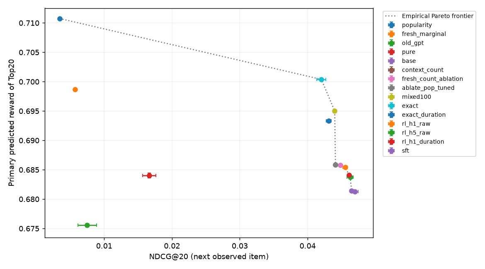
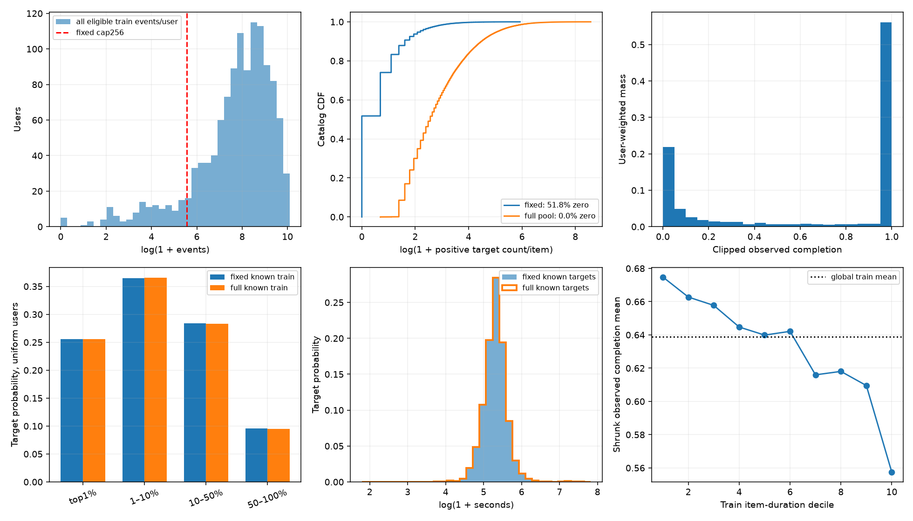
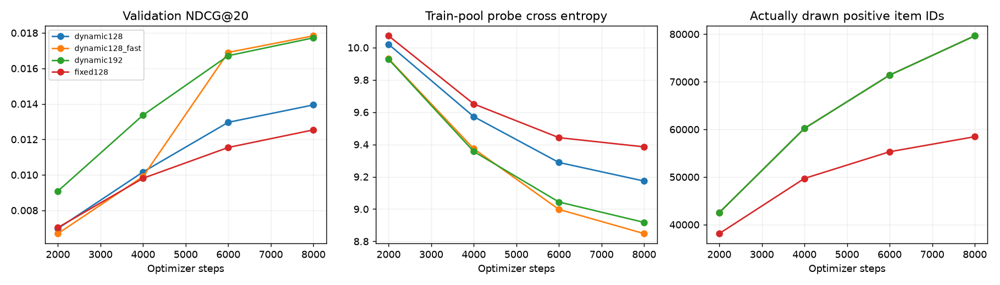
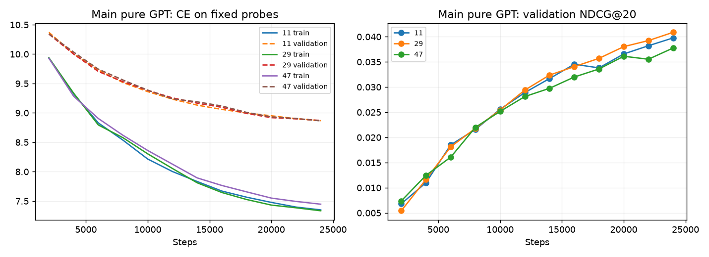
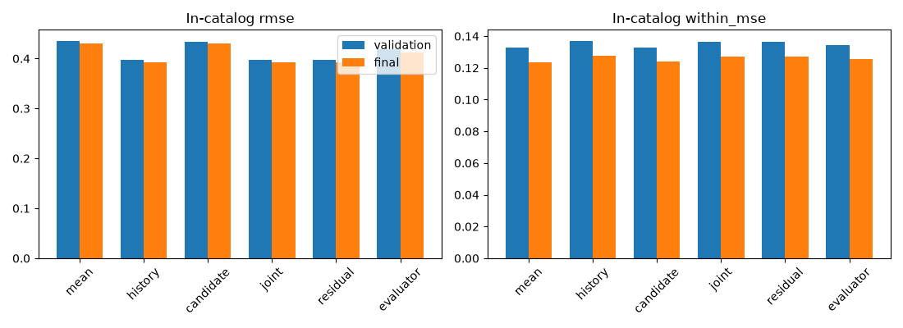
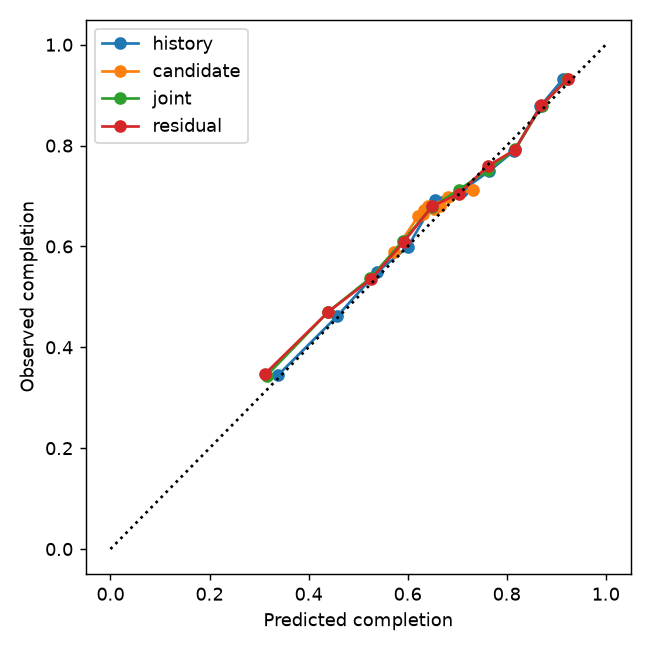
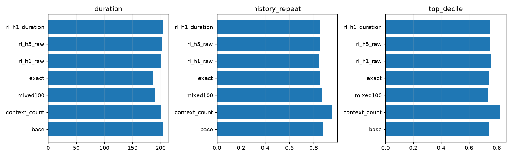
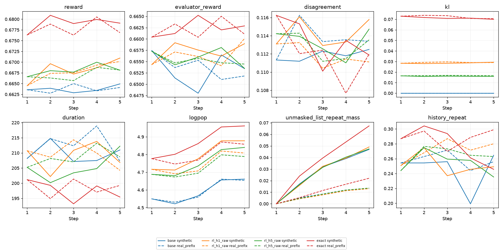

# study_03: проверка supervised support, candidate signal и ограниченного RL

> Архивное изложение study_03. Числа и история решений сохранены; ссылки и расположение кода адаптированы. Вывод о frontier ограничен прежними точками; более сильное сравнение приведено в [дополнении study_04](REPORT.md).

## Ключевые ответы

**1. Базовая модель усилена, но чистая GPT-2 всё ещё уступает частотам истории.** На одной новой final-когорте NDCG20 старой GPT —0.00749, новой чистой GPT —0.01665: Δ0.00916,95% CI[0.00702;0.01161]. Это эффект всей новой supervised-рецептуры, включая бюджет и schedule. Отдельный равнобюджетный sampling-контроль подтвердил увеличение positive support и снижение validation CE, но его NDCG CI пересекает0. При этом гибрид достиг0.04696 против0.04411 у history frequency. Его вклад сверх count+свежего полного train marginal мал: Δ0.00215, CI[0.00009;0.00435]; это пограничное nominal свидетельство, а не доказательство превосходства над всем классом простых моделей. Основная часть закрытия разрыва связана с явным copy-механизмом. [Контроль sampling](../results/study03/tables/cap_control_bootstrap.csv), [общие final contrasts](../results/study03/tables/paired_differences.csv).

**2. Проблема action-sensitive RM решена лишь частично.** В recommendable catalog joint RMSE0.39206 против history-only0.39273; разница total MSE незначима. Within-user MSE улучшилась на0.000652, CI[−0.001231;−0.000043], но сама within MSE0.12688 хуже постоянного predictor0.12347. На4580 matched pairs/410 пользователей concordance0.5221; её95% CI[0.4966;0.5475] включает случайный уровень0.5. Joint обходит history-only, который здесь ниже chance, но не candidate-only: Δconcordance0.00115, CI[−0.01667;0.01938]. Residual formulation не дала отдельного выигрыша. Таким образом, общий RMSE в основном объясняется user propensity, а надёжное персонализированное различение действий не установлено. Frozen evaluator также перенёсся хуже: RMSE0.41245 и calibration gap0.05186 против0.01045 у primary. Это центральное ограничение RL-интерпретации, а не основание подбирать новую RM по final. [RM domain](../results/study03/tables/reward_action_domain.csv), [paired errors](../results/study03/tables/reward_action_domain_bootstrap.csv), [matched CI](../results/study03/tables/reward_action_domain_matched.csv).

**3. RL даёт промежуточный offline-компромисс, а не бесплатное улучшение.** H1 raw повысил primary reward@20 на0.00419, CI[0.00389;0.00447], и evaluator reward на0.00216. Одновременно NDCG20 снизился на0.00142, CI[−0.00229;−0.00059]: около3% относительной потери, внутри заранее допущенных5%, но потеря статистически заметна. Прирост proxy больше, чем у compute-matched SFT, при худшей relevance. Выбранный rerank100 имеет больше reward и меньше NDCG; его final потеря relevance≈6.3%, хотя validation guard прошёл. Analytic H1 beta.1 максимизирует categorical J, но нарушал validation relevance guard на всех seeds и потерял≈10.5% final NDCG. Поэтому его нельзя объявлять допустимым serving-победителем по одному reward. RL находится на эмпирическом frontier показанных точек; превосходство над всей дешёвой reranking/beta кривой не доказано. Warm inference RL≈12.9ms/batch64 против≈20.1ms у rerank — возможная цена амортизации, без измерения production IO. [Основные results](../results/study03/tables/main_mean.csv), [admissibility](../results/study03/tables/validation_admissibility.csv), [differences](../results/study03/tables/paired_differences.csv).

**4. Сырой reward изменил поведение неоднозначно.** Относительно reference средняя длительность уменьшилась на3.03s, доля popular top-decile выросла на1.32pp, inter-user Jaccard вырос с0.00375 до0.00522, coverage снизилась с12.75% до12.39%. Это признаки глобальной концентрации. При этом recent-history repeats **уменьшились** на3.30pp, а artist distance выросла: гипотеза об обязательном росте повторов не поддержана, и разные виды diversity нельзя смешивать. Duration correction вернула2.65s — около87.5% исходного сдвига — и улучшила NDCG относительно raw H1 ценой0.00137 primary reward и0.00144 evaluator reward. Она даёт наблюдаемый компромисс длительности, но не доказывает улучшение удовлетворённости. [Behavior](../results/study03/tables/main_mean.csv), [paired changes](../results/study03/tables/paired_differences.csv), [examples](EXAMPLES_STUDY03.md).

**5. H5 не подтвердил рост пользовательского долгосрочного отклика.** При равных40960 actions H5 имеет меньше optimizer updates/initial contexts и лучше NDCG, но меньший Top20 reward, чем H1. В synthetic5-step оценке discounted raw return H5−H1≈0.00009, CI[−0.00594;0.00548]; J выше на0.00633, CI[0.00040;0.01170], главным образом из-за меньшего KL, а не большего response return. Гипотеза о росте disagreement с шагом не получила убедительного подтверждения. Обе RM используют почти статические FB/candidate summaries, поэтому это слабая диагностика sequence OOD; отсутствие роста disagreement не доказывает надёжность. В greedy Next5 H1 потерял NDCG5 относительно reference на0.00224, CI[−0.00370;−0.00096], при росте predicted reward. Добавление item в контекст — искусственная генерация, без наблюдённого consumption. Retention/churn не измерены как эффект политики; upstream survivor selection Yambda дополнительно ограничивает такой перенос. [Horizon returns](../results/study03/tables/horizon_return_bootstrap.csv), [step dynamics](../results/study03/tables/horizon_step5_minus1.csv), [Next5](../results/study03/tables/slate_bootstrap.csv).

Все интервалы nominal paired-user bootstrap, условны на замороженных RM и трёх policy fits; seed variability показана отдельно. Данные поддерживают улучшение supervised recipe и управляемое изменение model proxy. Доказательства улучшения реального пользовательского опыта или retention отсутствуют.

Все числа ниже получены завершёнными локальными запусками. Study01/02 сохранены без изменений. Работа мотивирована их известными результатами; для study03 зарезервирована новая когорта по сохранённым cohort ledgers, но источник и временной период те же. Это исследование на сокращённом131072 каталоге Yambda-50M, не результат на полном каталоге/популяции.

Финальная policy оценка: 500 пользователей, 3908 observed targets. RM-only diagnostic: 14906 targets. Три policy seeds11/29/47; один общий RM fit и один evaluator fit. OOV target mass (user macro): 30.33%. Все методы получают одинаковые реальные prefixes и одну next-logged-item цель. Даже нулевой logged response остаётся target: здесь relevance — операционное предсказание следующего зарегистрированного объекта, не доказанная удовлетворённость.

## Основная таблица: full chosen-catalog Top20

| Method | Val95% guard,seeds | NDCG20 ± seed SD | Recall20 | Primary RM@20 | Evaluator@20 | Coverage % | Duration,s | ms/batch64 |
| --- | --- | --- | --- | --- | --- | --- | --- | --- |
| Full-train user-balanced marginal | ablation | 0.00570 ± 0.00000 | 0.01240 | 0.69868 | 0.68251 | 0.02 | 170.8 | 5.93 |
| Count + fresh marginal, same alpha | ablation | 0.04482 ± 0.00000 | 0.09802 | 0.68577 | 0.66052 | 10.53 | 200.8 | 9.04 |
| Frozen GPT study02 | ablation | 0.00749 ± 0.00138 | 0.01861 | 0.67555 | 0.66040 | 7.52 | 203.8 | 9.05 |
| Pure GPT study03 | 0/3 | 0.01665 ± 0.00096 | 0.04252 | 0.68402 | 0.66308 | 6.34 | 199.1 | 9.30 |
| GPT + count mixture | 3/3 | 0.04696 ± 0.00051 | 0.10653 | 0.68126 | 0.65895 | 12.75 | 204.2 | 12.92 |
| Extra supervised | 3/3 | 0.04650 ± 0.00030 | 0.10650 | 0.68144 | 0.65890 | 12.52 | 203.9 | 12.88 |
| History frequency | 0/3 | 0.04411 ± 0.00000 | 0.09679 | 0.68585 | 0.66005 | 10.73 | 201.4 | 8.10 |
| Popularity | 0/3 | 0.00343 ± 0.00000 | 0.00983 | 0.71076 | 0.68118 | 0.02 | 178.2 | 6.55 |
| Count+pop, same alpha | 0/3 | 0.04411 ± 0.00000 | 0.09679 | 0.68585 | 0.66005 | 10.73 | 201.4 | 9.39 |
| Count+uniform, same alpha | 0/3 | 0.04411 ± 0.00000 | 0.09679 | 0.68585 | 0.66005 | 10.73 | 201.4 | 9.34 |
| Count+pop, tuned alpha | ablation | 0.04411 ± 0.00000 | 0.09679 | 0.68585 | 0.66005 | 10.73 | 201.4 | 9.41 |
| Count+uniform, tuned alpha | ablation | 0.04411 ± 0.00000 | 0.09679 | 0.68585 | 0.66005 | 10.73 | 201.4 | 9.33 |
| Mixed rerank100 | 3/3 | 0.04399 ± 0.00016 | 0.10036 | 0.69502 | 0.66847 | 12.53 | 190.7 | 20.08 |
| Analytic H1 raw | 0/3 | 0.04202 ± 0.00069 | 0.09792 | 0.70039 | 0.67121 | 12.30 | 186.9 | 19.82 |
| Analytic H1 duration | 3/3 | 0.04312 ± 0.00037 | 0.09775 | 0.69331 | 0.65904 | 12.54 | 211.6 | 20.32 |
| RL H1 raw | 3/3 | 0.04555 ± 0.00034 | 0.10492 | 0.68545 | 0.66111 | 12.39 | 201.1 | 12.88 |
| RL H5 raw | 3/3 | 0.04626 ± 0.00044 | 0.10536 | 0.68372 | 0.66035 | 12.43 | 202.2 | 13.04 |
| RL H1 duration | 3/3 | 0.04612 ± 0.00016 | 0.10572 | 0.68408 | 0.65967 | 12.48 | 203.8 | 12.92 |

± — sample SD трёх policy seeds, не CI. Повторённые deterministic controls не являются тремя независимыми fits. Reward@20 — среднее предсказаний для Top20; observed отклик на сгенерированные рекомендации отсутствует. Latency — median5 warm measurements после2 warmups, затем median seeds; без IO и подготовки history/FB, не production benchmark. Полные Recall/NDCG10/20, conditional known-target показатели и categorical expected reward/J: [main_seeds.csv](../results/study03/tables/main_seeds.csv).

## 1. Причина слабости GPT-2 и результат supervised доработки

Подтверждено: cap256/user оставлял 63241 из 131072 объектов доступными положительными CE targets (48.25%); у остальных51.75% были только input/negative-softmax gradients либо отсутствие positive updates. Полный eligible train pool содержит 5,384,237 known-target строк и 131072 разных targets. Это потенциальная поддержка, а не утверждение, что все объекты фактически обучены за конечный бюджет.

Fixed и dynamic controlled pilots имеют одинаковые seed/init/d128/L2/batch64/LR3e-4/wd.01/warmup/cosine schedule/8000 updates. Отличается доступный train sample. Оба user-first conditional on known target; небольшая разница со старым глобально conditioned sampler показана отдельно в data/sampling_audit.csv. Train/validation target populations совпадают по правилу all-listens, но отличаются временем, известностью каталога и долей повторов; data/target_distributions.csv содержит одинаковые user-macro знаменатели.

| Pilot | Best val NDCG20 | Known CE | Positive IDs actually drawn | Body,s |
| --- | --- | --- | --- | --- |
| dynamic128 | 0.01394 | 9.80870 | 79642 | 350.2 |
| dynamic128_fast | 0.01783 | 9.65329 | 79642 | 353.5 |
| dynamic192 | 0.01772 | 9.63312 | 79642 | 552.3 |
| fixed128 | 0.01253 | 10.09652 | 58459 | 352.0 |

| Dynamic−fixed, same8000 updates | Delta and paired95% CI | Users |
| --- | --- | --- |
| ndcg20 | 0.001407 [-0.000940; 0.003796] | 1090 |
| recall20 | 0.005505 [0.000000; 0.011009] | 1090 |
| ce | -0.287817 [-0.329369; -0.240564] | 1041 |

Уменьшение validation CE и увеличение target support — отдельные факты от неопределённого изменения NDCG. Без значимого ranking CI нельзя приписать sampling доказанный рост TopK. Дополнительный LR/capacity поиск ограничен двумя dynamic configurations. Новая main recipe выбирается по validation, затем обучается заново на24000 steps каждого seed. Main-vs-old сравнение на **одних новых final contexts** оценивает совокупный эффект recipe (sampling+schedule+budget), не изолированный эффект одного изменения.

| Shared-final contrast | NDCG20 delta [95% CI] |
| --- | --- |
| pure−old_gpt | 0.009156 [0.007020; 0.011607] |
| base−pure | 0.030313 [0.024181; 0.036990] |
| base−context_count | 0.002855 [0.001080; 0.004853] |
| base−ablate_pop | 0.002855 [0.001080; 0.004853] |
| base−ablate_pop_tuned | 0.002855 [0.001080; 0.004853] |
| base−fresh_count_ablation | 0.002147 [0.000091; 0.004348] |

Аудит не выявил ошибки преобразования item IDs/logits в recommendations: старые validation scores воспроизведены, service tokens отсутствуют в output head, same-timestamp readout инвариантен к перестановке, padding невидим, tiny-copy task обучается. Это не доказывает оптимальность архитектуры. Decoder readout/token groups/context64 остаются ограничениями. Copy mixture — явный гибрид, её выигрыш нельзя выдавать за способность чистого Transformer копировать. Count+pop/uniform ablations проверяют, даёт ли Transformer вклад сверх этой смеси. Результаты known repeated/novel целей в [target_strata.csv](../results/study03/tables/target_strata.csv).

## 2. RM: отличение объектов сверх пользовательской склонности

До RL выбрана joint. Первоначальный all-observed criterion и разработческое уточнение до in-catalog action domain раскрыты в [ANALYSIS_PLAN.md](DECISIONS_STUDY03.md). Веса/feature sets/calibration не переобучались при уточнении, primary осталась joint. Validation gate в правильном домене: Δwithin MSE -0.000887, CI[-0.001364;-0.000397], passed=True. Это выбранная validation-конфигурация; новое final оценивание ниже не участвовало в выборе, но остаётся внутри той же исходной cohort selection.

| In-catalog RM | Split | RMSE | MAE | Calibration | Within MSE | Between MSE | Matched concordance |
| --- | --- | --- | --- | --- | --- | --- | --- |
| mean | validation | 0.43583 | 0.41067 | 0.00447 | 0.13292 | 0.05702 | 0.50000 |
| history | validation | 0.39743 | 0.34923 | 0.01302 | 0.13715 | 0.02081 | 0.45962 |
| candidate | validation | 0.43432 | 0.40681 | 0.01273 | 0.13303 | 0.05561 | 0.52883 |
| joint | validation | 0.39677 | 0.34652 | 0.01326 | 0.13626 | 0.02116 | 0.53329 |
| residual | validation | 0.39675 | 0.34652 | 0.01217 | 0.13627 | 0.02114 | 0.53413 |
| evaluator | validation | 0.41883 | 0.38943 | 0.04992 | 0.13448 | 0.04093 | 0.51508 |
| mean | final | 0.43053 | 0.40681 | 0.02525 | 0.12347 | 0.06189 | 0.50000 |
| history | final | 0.39273 | 0.33988 | 0.01192 | 0.12753 | 0.02670 | 0.44809 |
| candidate | final | 0.42953 | 0.40296 | 0.02530 | 0.12420 | 0.06029 | 0.52093 |
| joint | final | 0.39206 | 0.33736 | 0.01045 | 0.12688 | 0.02683 | 0.52208 |
| residual | final | 0.39205 | 0.33736 | 0.00988 | 0.12690 | 0.02681 | 0.51882 |
| evaluator | final | 0.41245 | 0.38340 | 0.05186 | 0.12566 | 0.04445 | 0.51595 |

| Conditional final contrast | Metric | Delta [95% CI] |
| --- | --- | --- |
| joint−history | within | -0.000652 [-0.001231; -0.000043] |
| joint−history | mse | -0.000528 [-0.001352; 0.000369] |
| candidate−history | within | -0.003330 [-0.004768; -0.001968] |

| Matched final contrast | Concordance delta [95% CI] |
| --- | --- |
| joint−history | 0.073988 [0.043629; 0.103120] |
| joint−candidate | 0.001147 [-0.016668; 0.019377] |
| joint−chance | 0.022078 [-0.003364; 0.047540] |

History-only не получает кандидата. Candidate-only не получает history/uid. Joint содержит H,C,outer(H,C), past repeat interactions. Residual предсказывает y−available past mean, затем добавляет его обратно; этот baseline не использует среднее по будущим меткам пользователя. Все primary specs ridge fit<18M, hyper18–19M, calibration19–20M; evaluator CatBoost300/depth5/seed9011 обучен на случайной половине общего fit sample, разделяет часть priors с primary и не является полностью независимой оценкой истинного поведения.

Matched pairs — наблюдавшиеся разные items одного пользователя, gap<=6h, близкий past mean, response contrast>=.2; максимум20 пар/user, tie prediction=.5. Это умеренное выравнивание контекста, не рандомизированный item effect. Centered MSE использует test labels только для диагностики, никогда как признаки; история и время внутри пользователя тоже меняются. Сравнивайте within MSE также с постоянной mean моделью: значимый выигрыш над history-only сам по себе не гарантирует качественную action model. Совпадение RM/evaluator не доказывает принятие ненаблюдавшейся рекомендации.

Полные all-observed RM scores, strata по train-defined popularity/duration/history/support, matched-pair CI и calibration: [tables](../results/study03/tables/). Ограничение action-sensitive signal должно оцениваться по final результату, не только по общему RMSE.

## 3. Что RL добавляет относительно сильных альтернатив

Дополнительный static control заменяет GPT точным user-balanced marginal из полного eligible train<22M, при том же alpha; он отделяет свежесть частот от Transformer conditioning. Эти priors заморожены до final и не подбираются по его метрикам. Reference — выбранная по validation copy mixture; alpha фиксирован при всех SFT/RL updates. REINFORCE обучает GPT component того же распределения, p_count неизменён. Exact full-catalog KL, beta.1, gamma.9, H1raw640 updates и H5raw128 дают по40960 sampled actions/seed; H5 имеет меньше initial contexts и optimizer updates. Это equal-actions, не чисто isolated horizon effect и не equal-time. SFT получает max RL model/optimizer body seconds, dynamic targets, LR1e-4; его checkpoint выбирается тем же raw reward/95% relevance guard, что raw RL.

| Contrast | NDCG20 Δ [95% CI] | Primary reward Δ | Evaluator reward Δ |
| --- | --- | --- | --- |
| rl_h1_raw−base | -0.001416 [-0.002288; -0.000587] | 0.004186 [0.003893; 0.004474] | 0.002157 [0.001981; 0.002336] |
| rl_h1_raw−sft | -0.000952 [-0.001839; -0.000062] | 0.004007 [0.003691; 0.004293] | 0.002209 [0.002012; 0.002416] |
| rl_h1_raw−mixed100 | 0.001558 [0.000126; 0.003008] | -0.009574 [-0.010079; -0.009054] | -0.007357 [-0.007978; -0.006773] |
| rl_h1_raw−exact | 0.003525 [0.001603; 0.005329] | -0.014940 [-0.015634; -0.014287] | -0.010104 [-0.010821; -0.009431] |
| rl_h5_raw−rl_h1_raw | 0.000714 [0.000176; 0.001336] | -0.001723 [-0.001856; -0.001585] | -0.000755 [-0.000847; -0.000665] |
| rl_h1_duration−rl_h1_raw | 0.000577 [0.000079; 0.001098] | -0.001372 [-0.001480; -0.001267] | -0.001441 [-0.001556; -0.001325] |
| exact_duration−rl_h1_duration | -0.003001 [-0.005041; -0.000763] | 0.009231 [0.008622; 0.009910] | -0.000629 [-0.001280; 0.000006] |

Fixed-beta analytic controls показаны даже если нарушают validation relevance guard; это mathematical benchmarks, не автоматически допустимые serving configurations. Их положение на Pareto plot не заменяет guard. Более широкий beta sweep на новой политике не выполнялся, поэтому одна analytic точка не исчерпывает возможные дешёвые компромиссы. Analytic H1 q∝pi_ref exp(r/beta) — точный categorical максимум той же regularized objective на фиксированном state. Проверка RL≤q имеет0 violations; это не теорема о NDCG или Top20 reward. Mixed rerank использует100 reference candidates и validation lambda{0,2,5,10}; вне пула p=0. q имеет весь каталог. Online q/rerank используют real FB, native GPT/RL используют только item/group tokens; различие информации и serving cost не скрыто. Обе политики вычисляют контекстно зависимые рекомендации, но ни predicted reward, ни J не являются causal estimate пользовательского улучшения.

SFT selector audit (validation only): conventional best-NDCG weights также сохранены, но final сравнение использует тот же reward/relevance criterion, что raw RL; из него не следует, что продолжение SFT вообще бесполезно.

| Seed | SFT candidate | Chosen | Val NDCG20 | Val raw reward |
| --- | --- | --- | --- | --- |
| 11 | initial | False | 0.06946 | 0.66344 |
| 11 | best_ndcg | True | 0.06947 | 0.66389 |
| 11 | last | False | 0.06947 | 0.66389 |
| 29 | initial | False | 0.06972 | 0.66343 |
| 29 | best_ndcg | False | 0.06972 | 0.66343 |
| 29 | last | True | 0.06871 | 0.66389 |
| 47 | initial | False | 0.06855 | 0.66358 |
| 47 | best_ndcg | False | 0.06855 | 0.66358 |
| 47 | last | True | 0.06779 | 0.66374 |

## 4. Компромиссы: релевантность, длительность, популярность, повторы, персонализация

| Method | Duration,s | History repeat | Popular top10% | HHI | Inter-user Jaccard | Artist distance |
| --- | --- | --- | --- | --- | --- | --- |
| GPT + count mixture | 204.2 | 0.879 | 0.745 | 0.000349 | 0.0037 | 0.9460 |
| History frequency | 201.4 | 0.950 | 0.826 | 0.000683 | 0.0077 | 0.9552 |
| Extra supervised | 203.9 | 0.884 | 0.751 | 0.000349 | 0.0037 | 0.9467 |
| Mixed rerank100 | 190.7 | 0.874 | 0.737 | 0.000427 | 0.0044 | 0.9521 |
| Analytic H1 raw | 186.9 | 0.852 | 0.741 | 0.000526 | 0.0055 | 0.9548 |
| Analytic H1 duration | 211.6 | 0.864 | 0.736 | 0.000459 | 0.0049 | 0.9520 |
| RL H1 raw | 201.1 | 0.846 | 0.758 | 0.000487 | 0.0052 | 0.9475 |
| RL H5 raw | 202.2 | 0.855 | 0.756 | 0.000447 | 0.0049 | 0.9470 |
| RL H1 duration | 203.8 | 0.855 | 0.755 | 0.000445 | 0.0049 | 0.9468 |

| Duration correction−raw H1 | Delta [95% CI] |
| --- | --- |
| duration | 2.652980 [2.461287; 2.855421] |
| reward | -0.001372 [-0.001480; -0.001267] |
| evaluator_reward | -0.001441 [-0.001556; -0.001325] |
| history_repeat | 0.008401 [0.007349; 0.009550] |
| top_decile | -0.002974 [-0.003560; -0.002407] |

Единственная reward modification: r_adj=r_primary−(train shrunk response mean_duration_bin−global_mean), coefficient1,1000 pseudoobservations. Она убирает observational duration prior, не доказывает каузальную поправку; raw completion может поощрять короткие tracks, исправление может ухудшить raw reward. Не смешаны repetition/diversity/uncertainty penalties. Music repeats могут быть полезны: высокую history-repeat долю нельзя автоматически объявлять вредом. Внутри slate дубликаты запрещены одинаково всем; unmasked repeat mass анализируется отдельно. Coverage относится к выбранному каталогу, artist distance — только метаданные исполнителя, не semantic genre diversity.

Иллюстрации до/после с анонимными IDs и объяснённым правилом выбора: [EXAMPLES_STUDY03.md](EXAMPLES_STUDY03.md). Экстремальный пример proxy increase не выдаётся за типичного пользователя. Наблюдённый y относится только к историческому target, не к generated items. Popularity/верхний decile определены по зафиксированным ранним train<18M counts, а не по будущему final спросу.

## 5. Устойчивость, horizon и пределы вывода

Stochastic horizon diagnostic: 194 пользователей с5 последующими observed timestamp groups внутри final; это условная continuation subgroup. Initial anchor — earliest из сохранённых sampled targets пользователя, не случайное объявление retention population. Real-prefix и synthetic modes используют общие uniforms/masks и одинаковую first action. Synthetic append не означает consumption; FB frozen. У обеих RM нет sequence encoder: среди допустимых действий меняется в основном repeat fraction при truncation старого префикса, а уже выбранные IDs masked. Поэтому среда почти статична по feedback/candidate features; это слабый тест настоящих долгосрочных предпочтений и sequence OOD, что ограничивает интерпретацию agreement. В real-prefix доступны только реальные ранее наблюдённые события. Ни generated item не получает y несовпадающего реального шага.

Stepwise reward/evaluator/disagreement/KL/duration/popularity/repeat propensity и cumulative artist diversity: [horizon_steps.csv](../results/study03/tables/horizon_steps.csv), [horizon_diversity_steps.csv](../results/study03/tables/horizon_diversity_steps.csv). Paired step5−1 и synthetic−real step5 не равнозначны истинной ошибке reward model; known history fraction может механически расти от append известных каталогу IDs. Greedy Next5 relevance оценивается отдельно по тому же одному initial target, не смешивается с Top20 ranking.

Для ключевых differences bootstrap2000 пользователей после усреднения policy seeds внутри пользователя. Seed SD показана отдельно; интервалы nominal, без multiple-testing adjustment и без полной RM epistemic uncertainty. Повторяющаяся по seeds высокая proxy reward не означает причинный retention эффект. Общий RM/evaluator может систематически ошибаться вне logged action support. Проверки temporal guards относятся к зарегистрированным timestamps и раскрытому допущению доступности aggregate; реальные start/end/ingestion моменты не идентифицированы. На усиленной политике beta0 control не повторялся: отдельно доказать вклад KL в сохранение relevance по этим runs нельзя.

Long-term proxy next listen7d после session-end anchor с полным future window был проверен в study02; в study03 он не переобучался и не оптимизируется. Наш H5 — искусственный список, не модель будущих пользовательских взаимодействий. Кроме того, upstream отбор Yambda по активности в последующем периоде создаёт survivor selection: этот release не является случайной популяцией потенциально ушедших пользователей. Для retention нужен randomized online test возврата7d/активных дней/удовлетворённости, с guardrails skips, negative feedback, длительности, повторяемости и diversity по группам активности. Без exposures/logging propensities IPS/DR здесь не используется.

## Проверки, ресурсы и сдача

Локально M4 Pro48GiB/20GPU cores, MPS, Python3.12, torch2.14.1. Prior studies hash-check: 27810 files. Frozen policy/RM seal: 62 files. Независимо пересчитаны ranking formulas для 54 method×seed outputs; strict past guards и равный H1/H5 action budget passed. Полный small CPU pipeline и24 correctness tests проверены в отдельном locked environment и standalone export; exact reference reconstruction30 arrays. Подробности/логи: [REPRODUCIBILITY.md](REPRODUCIBILITY.md) и [PORTING.md](PORTING.md). Исходный protocol, раскрытые domain/development amendments и финальный policy seal различаются явно; они не заменены задним числом фиктивным preregistration.

Actual timing, selection и optimizer logs: [timing.csv](../results/study03/tables/timing.csv), seed folders heavy bundle, hardware/resources.json. Main optimizer body/awake elapsed не выдаются за календарную длительность: ноутбук переходил в clamshell sleep во время pilots. Peak unified memory не измерен; доступность48GiB и успешное выполнение не равны peak usage.

Компактный main bundle содержит source/configs/row selections/report/tables/figures. Heavy artifacts отдельно содержат checkpoints, mappings, prepared arrays и detailed events. Публичные parquet отдельно с pinned SHA. Всё численное здесь — выполненные эксперименты. Не выполнены: иные архитектуры/большие каталоги, дополнительный beta search, learned user transition model, online/causal retention evaluation.

Связь с первичными источниками и отличия от papers: [SOURCES.md](SOURCES.md). Ни числа benchmark, ни результаты предыдущих holdout не выдаются за effects новой версии.
